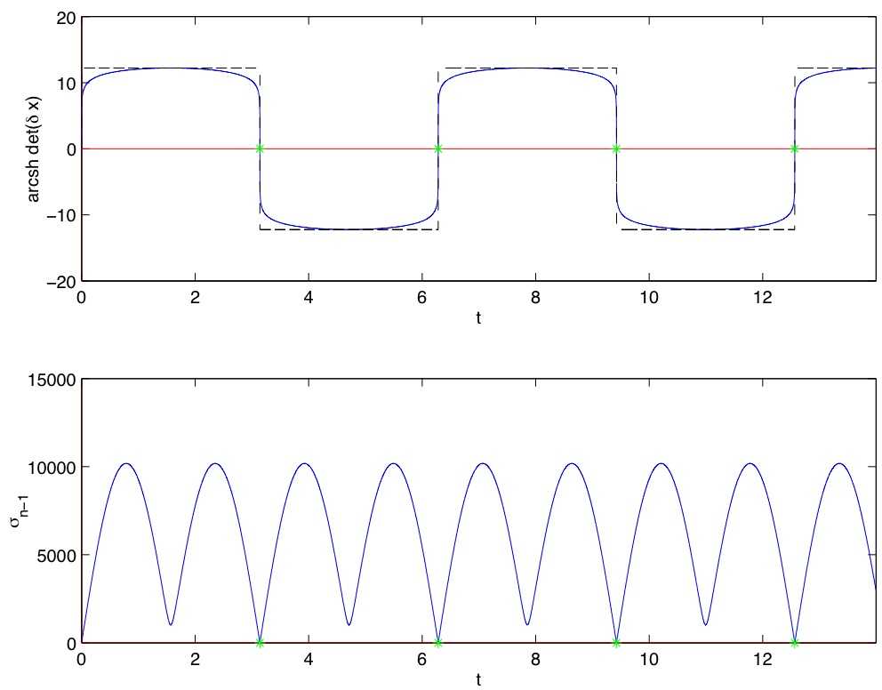

## Description

cotcot is a Matlab package designed to compute extremals in the case of *smooth* Hamiltonian systems, and to obtain the associated conjugate points with respect to the performance index of the underlying optimal control problem.

## References

[1] <a href="http://caillau.perso.math.cnrs.fr/research/cocv-2007.pdf">Second order optimality conditions in the smooth case and applications in optimal control</a> 
Bernard Bonnard, Jean-Baptiste Caillau and Emmanuel Trélat 
<i>ESAIM Control Optim. and Calc. Var.</i>, Vol. 13:2, pp. 207-236, 2007.

[2] <a href="http://caillau.perso.math.cnrs.fr/research/dcdsB-2005.pdf">Geometric optimal control of elliptic Keplerian orbits</a> 
Bernard Bonnard, Jean-Baptiste Caillau and Emmanuel Trélat 
<i>Discrete Contin. Dyn. Syst. Ser. B</i>, Vol. 5:4, pp. 929-956, 2005.

[3] <a href="http://caillau.perso.math.cnrs.fr/research/01582276.pdf">Computation of conjugate times in smooth optimal control: the COTCOT algorithm</a> 
Bernard Bonnard, Jean-Baptiste Caillau and Emmanuel Trélat 
<i>Proceedings of the 44th IEEE Conference on Decision and Control and European Control Conference ECC 2005</i>, pp. 929-933, Seville, December 2005.

[4] <a href="http://caillau.perso.math.cnrs.fr/research/anihp-2007.pdf">Riemannian metric of the averaged energy minimization problem in orbital transfer with low thrust</a> 
Bernard Bonnard and Jean-Baptiste Caillau 
<i>Ann. Inst. H. Poincaré Anal. Non Linéaire</i>, Vol. 24:3, pp. 395-411, 2007.

## Reproducible research

> *"An article about computational science in a scientific publication is not the scholarship itself, it is merely advertising of the scholarship. The actual scholarship is the complete software development environment and the complete set of instructions which generated the figures."*
> J. Buckheit and D. Donoho (Stanford Univ.)

[1] Figures 6 and 7 [code](cocv-2007.zip) 
[2] Figures 1 and 2 [code](dcdsB-2005.zip) 
[3] Figure 1, see [2] Figure 1 
[4] Figures 3, 4a-4d, 5 and 6a-6b [code](anihp-2007.zip)

## Download

cotcot [package](cotcot.zip) (Fortran 77, Adifor and Matlab 4 or higher required). 
Link to [Adifor](http://www-unix.mcs.anl.gov/autodiff/ADIFOR) at Rice.

## See also

[Hampath](https://gitlab.inria.fr/ct/hampath) which extends cotcot by adding a differential homotopy layer.

---

<small>Last modified: Fri 26 Nov 2009 14:41:56 CET</small>
